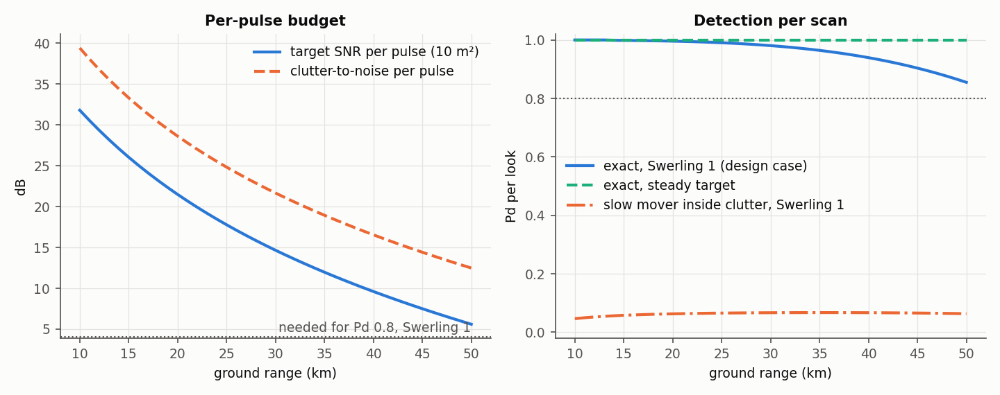
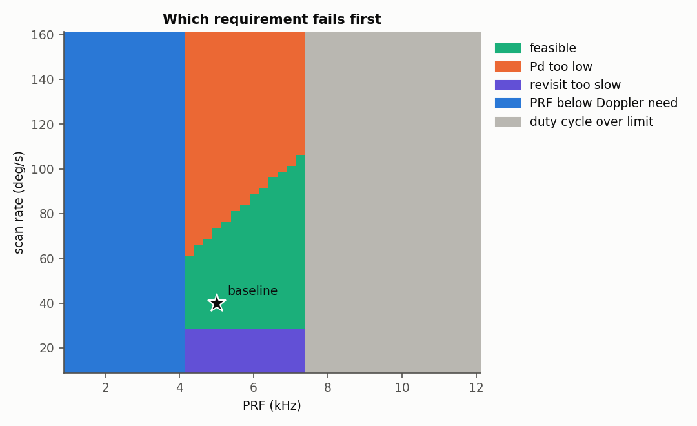
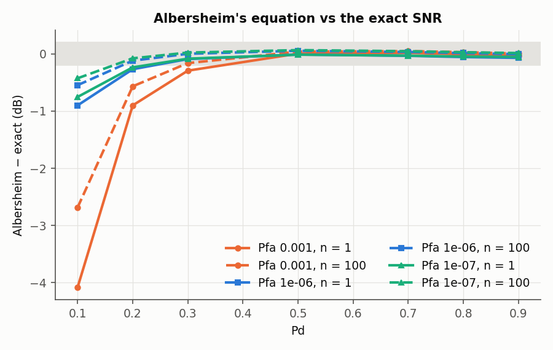
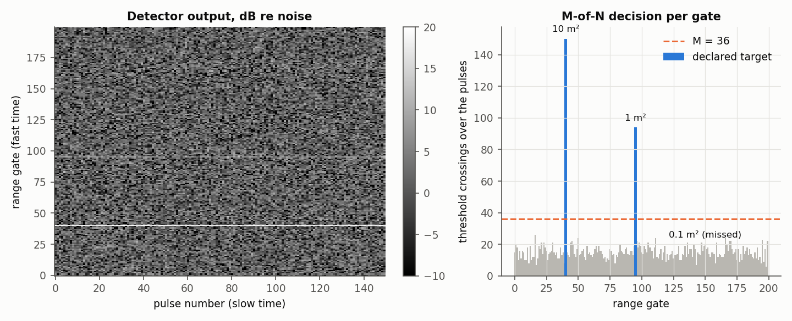
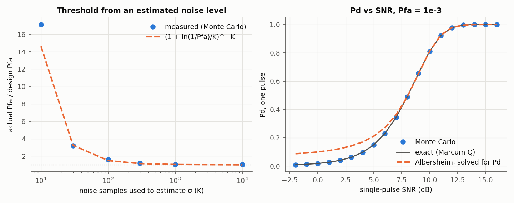
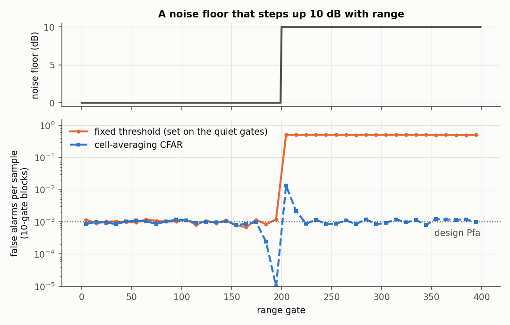

# Radar Detection Fundamentals: Pulse-Radar Design and Threshold Detection, Checked Against Exact Answers

Two connected projects on how a pulse radar finds a target:

1. **Design.** Size an X-band airborne radar that searches for moving ground vehicles.
   The work runs from the radar equation through Earth-curvature geometry, land
   clutter, Doppler and PRF limits, and scan timing to the probability of detection,
   followed by a trade study over PRF and scan rate.
2. **Detection.** Find echoes in that radar's range-gate × pulse matrix. The noise
   level is estimated from receiver-only data and the threshold is set for a required
   false-alarm probability. Detection is then integrated over the pulses (M-of-N),
   and the SNR and radar cross-section are estimated. A cell-averaging CFAR handles a
   noise floor that changes with range.

Every formula is checked against an independent answer before it is used: a closed
form, a direct numerical integral, or Monte Carlo.

**Where this comes from.** The two parts follow the arc of the two graduate radar
courses I took at the University of Central Florida, Introduction to Radar Systems
and Advanced Radar Systems. I later served as teaching assistant for both, several
times. This repository is a new implementation written in 2026 from textbook theory.
The scenario, parameters and code are its own, not the course assignments, and no
course material is included.

> ### What has been run
> | | Status |
> |---|---|
> | **pytest suite** (87 tests, offline) | **Passing** locally (Python 3.13). The GitHub Actions workflow runs it on Python 3.10–3.13. |
> | **Part 1**: baseline design, requirement checks, range budget, trade study over 2,745 PRF × scan-rate designs, Albersheim accuracy | **Run** (`python scripts/run_part1.py`, 3.7 min). Results in `results/part1/`, figures `figures/part1_*.png`. |
> | **Part 2**: one dwell with three echoes, noise estimation, binary-integration design, detections and RCS estimates; Monte Carlo checks of Pfa, Pd, M-of-N and CFAR | **Run** (`python scripts/run_part2.py`, 3 s, seed 20260427). Results in `results/part2/`, figures `figures/part2_*.png`. |
> | Coherent Doppler processing, elevation beam coverage, multiple-PRF range-ambiguity resolution, tracking | **Not modelled** (see [Scope](#honest-scope)). |

---

## Results at a glance

| Check | Result |
|---|---|
| Baseline design vs requirements | Meets all six. Pd **0.855** at 50 km against 0.80 required: 5.6 dB per pulse vs 4.1 dB needed, with 150 pulses. Revisit 3.0 s, resolution 12.5 m, MDV 1.0 m/s |
| Trade study, PRF × scan rate | **288 of 2,745** designs meet every requirement. PRF is confined to **4.25–7.25 kHz** by the Doppler floor and the duty-cycle limit. The fastest feasible scan rises from 60 to 105 deg/s across that window |
| Slow movers inside the clutter band | Target-to-clutter ratio **−6.9 dB** at 50 km, so Pd is **0.06** without Doppler separation |
| Albersheim's equation vs the exact square-law SNR | Within **0.28 dB** for Pd 0.5–0.9. At Pd 0.1 it under-states the needed SNR by up to **4.1 dB**. Solved for Pd at 0 dB SNR and Pfa 1e-3, it gives **0.10** against an exact **0.0185** (Monte Carlo 0.0182) |
| Single-pulse Pd, Monte Carlo vs Marcum Q | within **0.0013** from −2 to 16 dB (200,000 trials per point) |
| Threshold from a noise level estimated from K samples | Actual Pfa follows **(1 + ln(1/Pfa)/K)^−K**: **17×** the design 1e-4 at K = 10, **1.6×** at K = 100, **1.03×** at K = 1,000 |
| Binary integration, 150 pulses, gate Pfa 1e-6 | Best is a single-pulse Pfa of 0.1 with **M = 36**, costing **1.2 dB** against noncoherent integration. Pfa 1e-4 (M = 3) would cost 6.6 dB |
| Detection in one dwell | 10 m² and 1 m² found; RCS estimated as **9.9** and **0.93 m²**. The 0.1 m² echo (−6.1 dB per pulse, theory Pd 0.006) is missed. No false gates |
| Noise floor stepping up 10 dB | A fixed threshold's false-alarm rate rises from 1.0e-3 to **0.50**. CA-CFAR holds **1.02e-3**, apart from the edge |

---

## Part 1: designing the radar

### Scenario and requirements

An airborne surveillance radar at 6 km altitude, flying at 100 m/s. It scans a 120°
sector around broadside and looks for ground vehicles between 10 and 50 km ground
range.

| Requirement | Value |
|---|---|
| Target | 10 m², Swerling 1 (scan-to-scan fluctuation) |
| Pd per look at the far edge | ≥ 0.80 |
| Mean time between false alarms | 60 s, so Pfa = 1/(B·T_fa) = 1.4e-9 |
| Revisit | ≤ 4 s |
| Range resolution | ≤ 15 m |
| Radial speeds | measure ±30 m/s unambiguously; detect down to 2 m/s |
| Clutter | constant-gamma land, γ = −15 dB (assumed) |

### Baseline design

| Parameter | Value | Gives |
|---|---|---|
| Frequency | 10 GHz | λ = 3.0 cm |
| Peak power, pulse | 1 kW, 20 µs | duty 10 %, average power 100 W |
| Chirp bandwidth | 12 MHz | 12.5 m resolution; 23.8 dB compression gain |
| Beam | 1.2° az × 6.0° el | gain 35.6 dB; cross-range cell 1.06 km at 50 km |
| PRF | 5 kHz | blind speed 75 m/s; unambiguous range 30 km |
| Scan rate | 40 deg/s | revisit 3.0 s; 30 ms and 150 pulses on target |
| Noise figure, losses | 4 dB, 6 dB (assumed) | noise power −99.2 dBm |

Requirement checks (`results/part1/checks.csv`):

| Check | Value | Spec | |
|---|---|---|---|
| Pd at 50 km, Swerling 1 | 0.855 | ≥ 0.80 | pass |
| Revisit | 3.0 s | ≤ 4 s | pass |
| Range resolution | 12.5 m | ≤ 15 m | pass |
| PRF vs Doppler need (4v_max/λ + clutter spread) | 5,000 Hz | ≥ 4,142 Hz | pass |
| Duty cycle | 0.10 | ≤ 0.15 | pass |
| MDV vs slowest target | 1.04 m/s | ≤ 2 m/s | pass |
| Unambiguous range vs far edge (reported, not required) | 30.0 km | 50.4 km | ambiguous |

The last row is the classic medium-PRF compromise. A PRF high enough to measure
±30 m/s past the clutter cannot also be low enough for 50 km to be unambiguous in
range. Real systems resolve this with several PRFs; that is not modelled here.



At the far edge the target gives 5.6 dB per pulse, 1.5 dB above the 4.1 dB that
Pd 0.8 needs with 150 pulses. A steady target would be detected with Pd ≈ 1.0. The
gap is the fluctuation loss of a Swerling 1 target.

Clutter dominates everything that does not move. The cell is 12.5 m by 1 km, so the
target-to-clutter ratio is −6.9 dB at 50 km and −7.6 dB at 10 km. A vehicle moving
slower than the 1.0 m/s MDV sits inside the clutter Doppler band, where Pd is only
**0.06**. Doppler separation, not power, is what finds slow movers.

### Trade study



The feasible region is bounded on four sides:

- **Doppler (left).** PRF ≥ 4.14 kHz to see ±30 m/s past the clutter.
- **Duty cycle (right).** 20 µs × PRF ≤ 15 %, so PRF ≤ 7.5 kHz.
- **Revisit (bottom).** A 120° sector in ≤ 4 s needs ≥ 30 deg/s.
- **Pd (top).** Faster scans leave fewer pulses on target. At 4.25 kHz the fastest
  feasible scan is 60 deg/s; at 7.25 kHz it is 105 deg/s, because more pulses per
  dwell buy back the shorter dwell.

The baseline sits inside the region with room in every direction.

### Albersheim's equation, checked

Albersheim's equation is the closed form most design spreadsheets use for SNR,
Pd and Pfa. It was compared here with the exact square-law result (noncentral
chi-square, itself checked against a direct Marcum-Q integral and Monte Carlo):



For Pd 0.5–0.9 it is within 0.28 dB at every Pfa (1e-3 to 1e-7) and n (1, 10, 100)
tested. That is where designs live, so the baseline numbers stand.

At low Pd it is not accurate. At Pd 0.1 it under-states the required SNR by
0.4–4.1 dB, worst at Pfa 1e-3 and n = 1. Spreadsheets often invert it for Pd, and
that inversion over-states the Pd of a weak target. At 0 dB SNR and Pfa 1e-3 it
says 0.10; the exact value is 0.0185. This repository uses the exact result for
every design number and reports Albersheim only for comparison.

---

## Part 2: detecting the echoes

A 200-gate window of the baseline radar, from 30.0 to 32.5 km slant range, over one
dwell of 150 pulses. Three echoes sit in it, each with its SNR from the radar
equation: 10 m² (14.7 dB per pulse), 1 m² (4.3 dB) and 0.1 m² (−6.1 dB).

**1. Noise level from receiver-only data.** With the transmitter off, every sample is
Rayleigh. The mean-based estimate σ = mean(r)·√(2/π) gives 1.0018, and the
maximum-likelihood estimate σ² = mean(r²)/2 gives 1.0011; the true value is 1. Both
are unbiased over 400 repeats in `tests/`, and the ML estimate has the smaller
spread.

**2. Single-pulse threshold and M.** With a linear envelope detector,
Pfa = exp(−V_T²/2σ²). The gate is declared a target when at least M of the 150
pulses cross. For a gate-level Pfa of 1e-6 and Pd 0.9 (`results/part2/binary_integration.csv`):

| Single-pulse Pfa | M of 150 | SNR needed per pulse | Loss vs noncoherent (−2.3 dB) |
|---|---|---|---|
| 0.3 | 74 | −1.03 dB | 1.27 dB |
| **0.1** | **36** | **−1.08 dB** | **1.21 dB** |
| 0.03 | 18 | −0.37 dB | 1.93 dB |
| 0.01 | 11 | 0.64 dB | 2.93 dB |
| 0.001 | 5 | 2.60 dB | 4.90 dB |
| 0.0001 | 3 | 4.31 dB | 6.60 dB |

A low single-pulse threshold with a large M is best. A strict single-pulse threshold
throws away 5–7 dB.

**3. Detection and estimates.**



| Echo | True SNR | Crossings | Estimated SNR | Estimated RCS |
|---|---|---|---|---|
| 10 m² | 14.72 dB | 150 / 150 | 14.68 dB | 9.91 m² |
| 1 m² | 4.32 dB | 94 / 150 | 4.00 dB | 0.93 m² |
| 0.1 m² | −6.08 dB | below M | missed (theory Pd 0.006) | |

No noise-only gate was declared. The SNR estimate is
(mean r² − 2σ²)/2σ², and the RCS comes from inverting the radar equation at the
gate's range.

**4. Monte Carlo checks.**



- **Pd vs SNR, single pulse.** Monte Carlo is within 0.0013 of the Marcum-Q value
  from −2 to 16 dB. Albersheim's equation solved for Pd gives 0.087 at −2 dB, where the exact value is 0.009.
- **Pfa when σ is estimated.** If σ² comes from K noise samples, the realised Pfa
  is not the design value. Averaged over the estimate it is
  (1 + ln(1/Pfa)/K)^−K, the same algebra as CA-CFAR. Against a design of 1e-4:

  | K | 30 | 100 | 1,000 | 10,000 |
  |---|---|---|---|---|
  | Measured | 3.19e-4 | 1.62e-4 | 1.03e-4 | 1.02e-4 |
  | Formula | 3.25e-4 | 1.49e-4 | 1.04e-4 | 1.00e-4 |

  At K = 10 the run measured 1.71e-3 against 1.46e-3; with that few samples the
  Monte Carlo itself is noisy. `tests/` pins the formula to 4 % at Pfa 1e-2. In
  practice the threshold must come from hundreds of noise samples or more.
- **M-of-N, 36 of 150, gate Pd.** Measured vs binomial theory over 20,000 dwells:
  0.089 vs 0.093 at −4 dB, 0.288 vs 0.285 at −3 dB, 0.629 vs 0.627 at −2 dB, and
  0.915 vs 0.915 at −1 dB.

**5. A noise floor that changes with range.**



The noise steps up 10 dB at gate 200. A threshold set on the quiet gates gives a
false-alarm rate of 1.0e-3 there and **0.50** beyond the step. Cell-averaging CFAR
uses 16 training gates on each side and 2 guard gates, with
α = N(Pfa^(−1/N) − 1). It holds 0.98e-3 and **1.02e-3** in the two regions.

At the edge (gates 190–210) CFAR averages 6.7e-3. Just before the step, louder
training cells raise the threshold and false alarms nearly vanish (masking); just
after it, quieter ones lower the threshold and they overshoot. The same detector
with a sea-clutter model is the core of my
[Sentinel-1 ship detector](https://github.com/ruiyao-chen/sentinel1-ship-detect).

---

## Model choices and their sources

| Piece | Choice | Source |
|---|---|---|
| Radar equation | energy form, P_t·τ·G²λ²σ / ((4π)³R⁴kT₀FL) | standard (Skolnik, *Introduction to Radar Systems*) |
| Antenna gain | G ≈ 26,000 / (θ_az·θ_el), degrees | Skolnik rule of thumb |
| Geometry | smooth sphere, 4/3 Earth radius | standard refraction |
| Clutter | σ⁰ = γ sin ψ, γ = −15 dB; pulse- or beam-limited cell | constant-gamma model; γ **assumed** |
| False-alarm time | Pfa = 1/(B·T_fa) | Skolnik |
| Exact Pd | noncentral chi-square (Swerling 0); exponential average (Swerling 1) | Marcum; Swerling |
| Approximate Pd | Albersheim's equation | Albersheim 1981 |
| Clutter Doppler | spread 2Vθ_az sin φ cos ψ / λ; MDV = half of it in speed | standard airborne MTI geometry |
| CA-CFAR | α = N(Pfa^(−1/N) − 1), square-law samples | exact for exponential noise |
| Noise figure 4 dB, losses 6 dB, atmosphere 0.02 dB/km two-way | **assumed** | typical X-band values |

## Honest scope

- **Noncoherent integration only.** A real moving-target radar filters in Doppler
  coherently, which adds gain and is what separates slow movers from clutter. Here the
  Doppler limits are computed but detection uses noncoherent integration, so the
  exo-clutter Pd is conservative. The endo-clutter Pd treats the clutter like noise,
  which is optimistic.
- **Range ambiguity is reported, not resolved.** The 5 kHz design is ambiguous beyond
  30 km; staggered PRFs are the usual fix.
- **The elevation beam is not modelled.** One 6° beam cannot cover grazing angles from
  6.7° to 30.9°; the gain is computed as if it did.
- **Echoes are simulated.** Part 2 uses complex Gaussian noise and steady or Swerling 1
  targets; there are no real radar data here.
- **Not the original coursework.** This is a new implementation of the same ideas,
  with its own scenario and numbers.

## Quickstart

```bash
pip install -r requirements.txt
python -m pytest -q                 # 87 tests, ~3 s
python scripts/run_part1.py         # design, checks, trade study, Albersheim (~4 min; --fast for ~20 s)
python scripts/run_part2.py         # detection and Monte Carlo checks (~3 s)
```

## Repository layout

```
radar-detection-fundamentals/
├── src/pulseradar/
│   ├── config.py      constants, scenario (requirements), baseline design
│   ├── geometry.py    slant range, grazing and ground range over a 4/3 Earth
│   ├── radar_eq.py    gain, noise, single-pulse SNR, RCS from SNR
│   ├── detection.py   Pfa from T_fa; Albersheim; exact Swerling 0/1; M-of-N
│   ├── clutter.py     constant-gamma clutter, cell area
│   ├── doppler.py     clutter Doppler, MDV, PRF limits, blind speeds, ambiguity
│   ├── design.py      evaluate a design; PRF x scan-rate trade study
│   ├── echoes.py      Part 2: echo matrix, noise estimators, threshold, CA-CFAR
│   └── plotting.py    figures
├── scripts/run_part1.py, scripts/run_part2.py
├── tests/             87 tests against closed forms, integrals and Monte Carlo
├── results/part1/, results/part2/   CSV, summary.json, run_info.json, run_log.txt
└── figures/
```

## Author

Ruiyao Chen. Ph.D. in electrical engineering (electromagnetics and signal
processing); satellite remote sensing, sensor calibration and validation.

## License

MIT; see [LICENSE](LICENSE).
